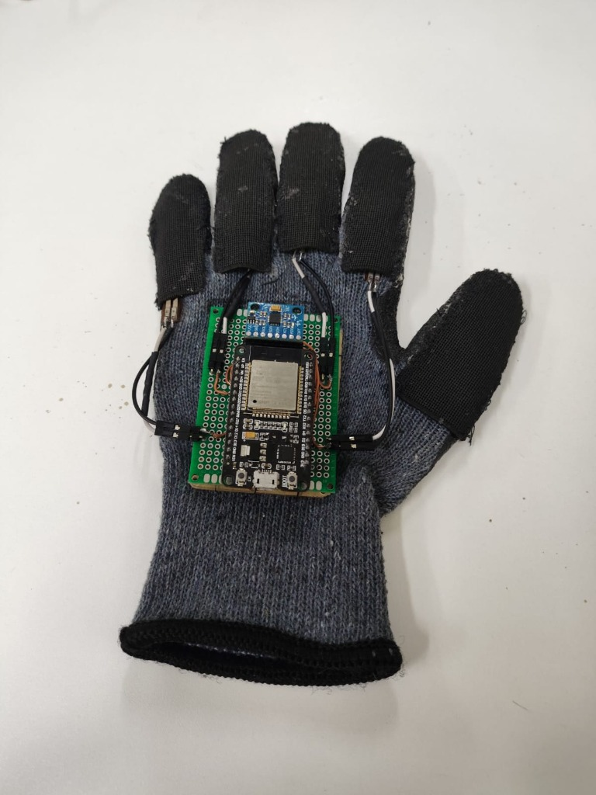
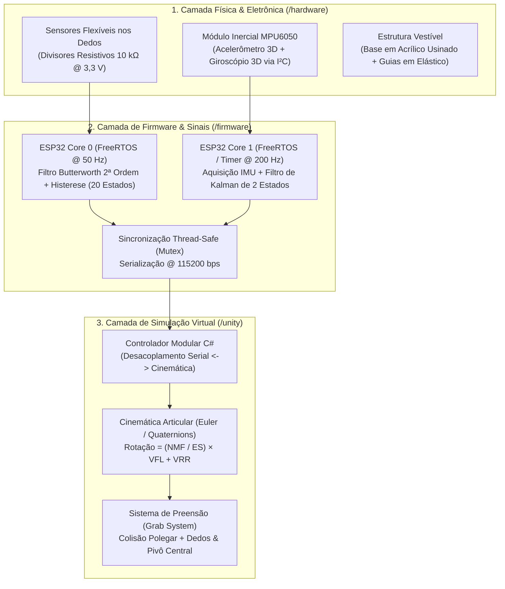

<div align="center">

# 🧤 L-UVA — Luva de Realidade Virtual de Baixo Custo
### **Laboratório de Visualização, Interação e Simulação (L-VIS) · Universidade de Brasília (UnB)**

[-003366?style=for-the-badge)](https://www.unb.br/)
[](https://github.com/L-VIS)
[](./hardware)
[](./unity)
[](./LICENSE)

**Plataforma ciberfísica vestível de baixo custo para rastreamento cinemático da mão, fusão sensorial inercial em tempo real e interação tridimensional imersiva.**

[Visão Executiva](#-visão-executiva-e-proposta-de-valor) •
[Arquitetura Técnica](#-arquitetura-do-sistema) •
[Estrutura do Repositório](#-estrutura-do-repositório) •
[Começando](#-como-executar-o-projeto) •
[Roadmap & Investimento](#-roadmap-tecnológico-e-oportunidades-de-investimento)

<br>



<p><sub><b>Figura 1:</b> Protótipo funcional integrado da <b>L-UVA</b> — Luva têxtil instrumentada com 5 sensores flexíveis em guias de elástico, chassi dorsal em acrílico usinado, placa universal com conectores modulares, unidade <b>ESP32-WROOM-32 DevKit V1</b> e módulo inercial <b>MPU6050 (GY-521)</b>.</sub></p>

</div>

---

## 🚀 Visão Executiva e Proposta de Valor

A interação natural com as mãos é a fronteira definitiva da **Realidade Virtual (VR)**, da ** teleoperação robótica** e da **reabilitação neuromotora**. Contudo, luvas sensoriais comerciais (*data gloves*) possuem custos proibitivos — frequentemente superiores a **US\$ 2.500 a US\$ 5.000 por unidade** —, além de arquiteturas proprietárias fechadas que inviabilizam sua adoção em larga escala em universidades, clínicas, indústrias e centros de treinamento na América Latina.

O projeto **L-UVA**, desenvolvido no **Laboratório de Visualização, Interação e Simulação (L-VIS)** da **Faculdade de Tecnologia da Universidade de Brasília (UnB)**, soluciona esse gargalo ao entregar uma **luva de captura de movimento de baixo custo e alta confiabilidade técnica**, projetada desde a base para manufatura acessível, manutenção modular e integração transparente com motores gráficos modernos.

### Diferenciais Competitivos (Deep-Tech & Custo-Eficiência)
- **Redução Drástica de CAPEX (>90%)**: Construída com componentes amplamente disponíveis no mercado nacional (**ESP32**, **MPU6050** e sensores flexíveis resistivos), mantendo o custo de prototipagem em uma fração mínima das soluções importadas.
- **Processamento Determinístico Dual-Core (FreeRTOS)**: Arquitetura embarcada multitarefa que isola a amostragem analógica dos dedos (Núcleo 0 a $50\text{ Hz}$) da comunicação inercial $\text{I}^2\text{C}$ e telemetria serial (Núcleo 1), com sincronização protegida por *Mutexes*.
- **Filtragem Digital e Fusão Sensorial Rigorosa**: Implementação embarcada de filtros digitais **Butterworth de 2ª Ordem** com histerese anti-ruído para os dedos e **Filtro de Kalman Escalar de 2 Estados ($200\text{ Hz}$)** com matriz de covariância adaptativa ($R$ dinâmico) para estimação precisa de orientação ($\text{Roll}$ e $\text{Pitch}$) sem deriva (*drift*).
- **Engenharia Vestível Modular**: Fixação mecânica baseada em chassi de acrílico usinado com dupla furação (costura cirúrgica no dorso têxtil + parafusamento independente do circuito), permitindo manutenção eletrônica rápida sem desmontar a luva.

### Verticais de Aplicação e Potencial de Mercado
| Vertical | Aplicação Prática | Impacto Gerado |
| :--- | :--- | :--- |
| **Saúde & Reabilitação** | Fisioterapia motora gamificada e avaliação funcional pós-AVC ou trauma ortopédico | Métricas objetivas de evolução de amplitude articular com baixo custo para clínicas e hospitais |
| **Indústria 4.0 & Treinamento** | Simulação imersiva de montagem, manutenção e operação de equipamentos críticos | Redução de riscos operacionais e custos de treinamento físico |
| **Educação & Acessibilidade** | Laboratórios virtuais interativos e captura gestual para tecnologias assistivas (ex.: Libras) | Democratização do acesso a interfaces tridimensionais no ensino superior e técnico |

---

## 🧠 Arquitetura do Sistema

A **L-UVA** integra três camadas tecnológicas fortemente acopladas em desempenho e desacopladas em arquitetura modular:



### Destaques da Engenharia de Software e Hardware

1. **Condicionamento e Filtragem Digital dos Dedos ([`firmware/src/main_luva_freertos.cpp`](./firmware/src/main_luva_freertos.cpp))**:
   - Leitura em resolução de **12 bits** ($0$ a $4095$) atenuada em $11\text{ dB}$.
   - Filtro passa-baixas **Butterworth de 2ª Ordem** ($f_c = 5\text{ Hz}$, $f_s = 50\text{ Hz}$) projetado via transformação bilinear com inicialização imediata de estado estacionário.
   - Quantização em **$20$ estados discretos** estabilizada por **banda de histerese ($\pm 0,2$)**, eliminando oscilações visuais (*jitter*) na mão virtual.

2. **Fusão Sensorial Inercial de 2 Estados ([`firmware/kalman_imu/kalman_2_estados_mpu6050.cpp`](./firmware/kalman_imu/kalman_2_estados_mpu6050.cpp))**:
   - Estima simultaneamente o ângulo de inclinação e a deriva instantânea do giroscópio ($\mathbf{x} = [\theta, \ \text{bias}]^T$) a **$200\text{ Hz}$** via `esp_timer`.
   - **Rejeição de Aceleração Linear**: Detecção dinâmica de movimento que escalona a covariância de medição ($R$) durante translações rápidas da mão, impedindo que forças inerciais corrompam a referência gravitacional.

3. **Cinemática Articular e Preensão na Unity 3D ([`unity/README.md`](./unity/README.md))**:
   - Malha 3D baseada no modelo de mão da **Meta**, com hierarquia de ossos (*rigging*) reformulada para atuação paramétrica.
   - Rotação de cada falange calculada em função do Número Máximo da Flexão ($\text{NMF}$), Quantidade de Estados ($\text{ES}$), Valor da Flexão da Luva ($\text{VFL}$) e Valor de Rotação em Repouso ($\text{VRR}$):
     $$\theta_{\text{articulação}} = \left(\frac{\text{NMF}}{\text{ES}}\right) \times \text{VFL} + \text{VRR}$$
   - **Grab System**: Lógica de captura de objetos baseada no contato simultâneo entre o polegar e qualquer outro dedo, vinculando o objeto ao eixo pivô central da palma da mão.

---

## 📂 Estrutura do Repositório

O repositório está organizado seguindo padrões industriais de projetos de sistemas embarcados e realidade virtual:

```text
L-UVA/
├── docs/                                         # Relatórios técnicos, especificações e fotos do protótipo
│   ├── assets/                                   # Fotografias em alta resolução do hardware e da luva montada
│   │   ├── luva_prototipo_completo.jpg           # Vista superior completa da luva L-UVA instrumentada (5 dedos)
│   │   ├── circuito_perspectiva_acrilico.jpg     # Detalhe em perspectiva (placa universal + base em acrílico)
│   │   └── circuito_macro_conexoes.jpg           # Vista macro das conexões ESP32, MPU6050 e conectores flex
│   ├── README.md                                 # Índice da documentação técnica
│   ├── hardware-e-soldagem.md                    # Mapa elétrico, netlist, soldagem, acrílico/costura e troubleshooting
│   └── arquitetura-simulacao.md                  # Modelagem matemática (Butterworth, Kalman e Cinemática Unity)
├── firmware/                                     # Códigos embarcados C/C++ para ESP32
│   ├── README.md                                 # Guia de arquitetura do firmware, FreeRTOS e compilação
│   ├── src/
│   │   └── main_luva_freertos.cpp                # Firmware principal Dual-Core FreeRTOS (Flex + MPU6050)
│   ├── kalman_imu/
│   │   └── kalman_2_estados_mpu6050.cpp          # Fusão sensorial via Filtro de Kalman de 2 Estados (200 Hz)
│   └── test_bench/
│       └── validacao_adc_sensores.ino            # Firmware de validação elétrica de bancada dos canais ADC
├── hardware/                                     # Engenharia eletrônica, pinagem e manufatura mecânica
│   ├── README.md                                 # Arquitetura eletrônica, pinagem I²C/ADC e montagem estrutural
│   └── BOM.md                                    # Lista de Materiais (Bill of Materials) e estimativa de custos
├── unity/                                        # Ambiente de Simulação 3D e Realidade Virtual (Reservado)
│   ├── README.md                                 # Especificação do Rigging, Equação Cinemática e Grab System
│   └── .gitkeep                                  # Diretório reservado para integração do pacote Unity 3D
├── .gitignore                                    # Regras de exclusão para Unity, PlatformIO, Arduino e EDA
├── CONTRIBUTING.md                               # Diretrizes de contribuição e padrões de código do L-VIS
├── LICENSE                                       # Licença Open-Source MIT (L-VIS / UnB)
└── README.md                                     # Apresentação executiva e visão geral do projeto
```

---

## 🛠️ Como Executar o Projeto

### 1. Montagem e Validação Elétrica de Bancada
1. Consulte a **[Lista de Materiais (`hardware/BOM.md`)](./hardware/BOM.md)** e o **[Guia de Hardware e Soldagem (`docs/hardware-e-soldagem.md`)](./docs/hardware-e-soldagem.md)**.
2. Realize a inspeção a frio (continuidade dos barramentos laterais `3V3` e `GND` e isolamento entre pinos adjacentes).
3. Grave o firmware de validação **[`firmware/test_bench/validacao_adc_sensores.ino`](./firmware/test_bench/validacao_adc_sensores.ino)** na ESP32 e verifique no Monitor Serial (`115200 bps`) a excursão limpa dos sensores flexíveis entre $0$ e $4095$.

### 2. Gravação do Firmware de Produção
1. Instale as bibliotecas `Adafruit MPU6050`, `Adafruit Unified Sensor` e `MPU6050_light` na Arduino IDE ou PlatformIO.
2. Compile e carregue **[`firmware/src/main_luva_freertos.cpp`](./firmware/src/main_luva_freertos.cpp)** na **ESP32 DevKit V1**.
3. Para análise isolada de fusão sensorial no *Serial Plotter* a $200\text{ Hz}$, utilize **[`firmware/kalman_imu/kalman_2_estados_mpu6050.cpp`](./firmware/kalman_imu/kalman_2_estados_mpu6050.cpp)**.

### 3. Simulação na Unity 3D
- A documentação completa da arquitetura de scripts e integração serial encontra-se em **[`unity/README.md`](./unity/README.md)**, onde o pacote do projeto Unity do laboratório será disponibilizado.

---

## 📈 Roadmap Tecnológico e Oportunidades de Investimento

O projeto **L-UVA** encontra-se em estágio de **Protótipo Funcional Validado em Laboratório (TRL 4–5)** e busca parceiros estratégicos, editais de fomento e investidores para acelerar a transição para **Produto de Engenharia (TRL 6–7)**:

- [x] **Fase 1 — Prova de Conceito e Eletrônica Modular**: Validação dos divisores resistivos, montagem em placa universal com espaçamento de segurança e fixação mecânica em acrílico/têxtil.
- [x] **Fase 2 — Processamento Digital Embarcado**: Arquitetura Dual-Core FreeRTOS, filtro Butterworth de 2ª Ordem, discretização com histerese e Filtro de Kalman de 2 estados calibrado experimentalmente.
- [x] **Fase 3 — Simulação Cinemática e Interação Básica**: Reformulação de *rigging* da mão virtual na Unity, controlador cinemático por estados e mecânica de *Grab*.
- [ ] **Fase 4 — Integração Unificada & Colisores Avançados (Em Andamento)**: Consolidação do pacote Unity no repositório, refinamento da animação de preensão e envelopamento de *hitboxes* da mão.
- [ ] **Fase 5 — Miniaturização em PCB Dedicada (Próximo Marco)**: Migração da placa universal para Placa de Circuito Impresso (PCB) compacta de dupla face com filtragem capacitiva ($100\text{ nF}$) e conectores miniaturizados.
- [ ] **Fase 6 — Operação Totalmente Sem Fio & Feedback Háptico**: Transmissão de baixa latência via Wi-Fi/ESP-NOW ou BLE, sistema de bateria LiPo com gerenciamento de recarga embarcado e atuadores de retorno tátil.

---

## 🏛️ Instituição, Histórico de P&D e Equipe

Projeto desenvolvido no âmbito do **Laboratório de Visualização, Interação e Simulação (L-VIS)** da **Faculdade de Tecnologia (FT)** da **Universidade de Brasília (UnB)**, sob orientação do **Prof. Félix**.

### Continuidade Institucional e Evolução Tecnológica
Este repositório representa a **nova geração e continuidade direta** das pesquisas de captura de movimento iniciadas no laboratório por meio do projeto precursor **[`lvis-luva-de-dados`](https://github.com/GabrielPyva/lvis-luva-de-dados)** (conduzido sob a gestão anterior de [Gabriel Pyva](https://github.com/GabrielPyva)). A partir dos alicerces estabelecidos na geração base, a atual gestão reestruturou integralmente a arquitetura de hardware, o processamento digital de sinais em tempo real (FreeRTOS, Butterworth e Filtro de Kalman) e a modelagem cinemática na Unity 3D, consolidando o amadurecimento contínuo de P&D dentro do **L-VIS / UnB**.

- **Gestão Atual & Engenharia**: Equipe L-VIS / UnB
- **Projeto Precursor (Geração Base)**: [GabrielPyva/lvis-luva-de-dados](https://github.com/GabrielPyva/lvis-luva-de-dados)
- **Localização**: Campus Universitário Darcy Ribeiro, Faculdade de Tecnologia — Brasília, DF, Brasil.

> **Para investidores, empresas parceiras e agências de fomento**: Caso tenha interesse em apoiar o desenvolvimento da **L-UVA**, financiar bolsas de P&D, licenciar aplicações ou estabelecer parcerias tecnológicas com o **L-VIS / UnB**, entre em contato por meio das *Issues* deste repositório ou pelos canais institucionais do laboratório.

---

<div align="center">
  <sub>Desenvolvido com excelência acadêmica no <b>L-VIS · Universidade de Brasília (UnB)</b> · Distribuído sob a <a href="./LICENSE">Licença MIT</a>.</sub>
</div>
