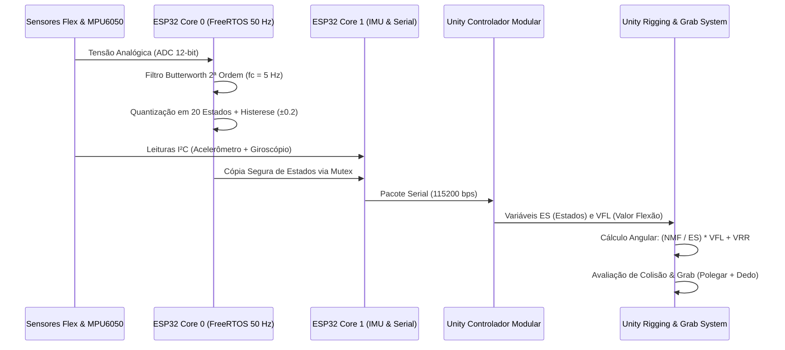

# Arquitetura de Simulação 3D, Cinemática Articular e Processamento de Sinais

**Instituição**: Universidade de Brasília (UnB) — Faculdade de Tecnologia (FT)  
**Laboratório**: L-VIS (Laboratório de Visualização, Interação e Simulação)  
**Escopo**: Modelagem matemática de filtros digitais embarcados, fusão sensorial inercial e cinemática da mão virtual na Unity 3D.

---

## 1. Pipeline End-to-End de Dados (Da Luva Física ao Ambiente Virtual)

A **L-UVA** opera como um sistema ciberfísico em malha aberta de baixa latência, convertendo grandezas físicas analógicas e inerciais em transformações geométricas tridimensionais na engine **Unity**:

---

## 2. Processamento Digital de Sinais nos Sensores Flexíveis

### 2.1. Filtragem Passa-Baixas Butterworth de 2ª Ordem
Para eliminar ruídos elétricos de conversão analógico-digital e oscilações mecânicas de alta frequência sem introduzir atraso de fase perceptível ao usuário em Realidade Virtual, cada dedo possui uma instância independente de um filtro IIR **Butterworth de 2ª ordem** ($f_s = 50\text{ Hz}$, $f_c = 5\text{ Hz}$).

A partir da frequência pré-distorcida $K = \tan(\pi f_c / f_s)$ e do fator de amortecimento $\sqrt{2}$, os coeficientes da equação a diferenças na Forma Direta II são dados por:

$$D = 1 + \sqrt{2}K + K^2$$

$$b_0 = \frac{K^2}{D}, \quad b_1 = \frac{2K^2}{D}, \quad b_2 = \frac{K^2}{D}$$

$$a_1 = \frac{2(K^2 - 1)}{D}, \quad a_2 = \frac{1 - \sqrt{2}K + K^2}{D}$$

### 2.2. Quantização com Histerese Anti-Chattering
O sinal filtrado $y[n]$ é mapeado para a faixa normalizada $p \in [0, 1]$ e projetado no espaço discreto de $N_{\text{estados}} = 20$:

$$\text{pos} = p \cdot (N_{\text{estados}} - 1)$$

A transição para um novo estado discreto $E_{k}$ ocorre somente quando a posição contínua ultrapassa o limiar de decisão acrescido da banda de histerese $H = 0,2$:

$$|\text{pos} - E_{k-1}| > 0,5 + H$$

---

## 3. Fusão Sensorial Inercial (Filtro de Kalman de 2 Estados)

Na estimação de orientação da mão ($\text{Roll}$ e $\text{Pitch}$) a $200\text{ Hz}$, a integração direta da velocidade angular $\omega$ do giroscópio sofre com deriva (*drift*) de baixa frequência, enquanto a inclinação trigonométrica obtida pelo acelerômetro ($\theta_{\text{acc}}$) é contaminada por ruído de alta frequência e acelerações translacionais da mão.

O **Filtro de Kalman Escalar de 2 Estados** resolve esse compromisso estimando o vetor de estado $\mathbf{x} = [\theta, \ b]^T$:

1. **Etapa de Predição (*A Priori*)**:
   $$\hat{\theta}_{k|k-1} = \hat{\theta}_{k-1|k-1} + (\omega_k - \hat{b}_{k-1|k-1})\Delta t$$
   $$\mathbf{P}_{k|k-1} = \mathbf{F}\mathbf{P}_{k-1|k-1}\mathbf{F}^T + \mathbf{Q}$$
2. **Adaptação Dinâmica de $R$ sob Movimento**:
   Quando a norma da aceleração diverge de $1g$ ($|\|\mathbf{a}\| - 1| > 0,15g$) ou a magnitude angular excede $10^\circ/\text{s}$, a variância de medição $R$ é multiplicada por `FATOR_R_MOVIMENTO = 3.0`, blindando a estimativa de inclinação contra movimentos rápidos do braço.
3. **Etapa de Atualização (*A Posteriori*)**:
   $$S_k = P_{00, k|k-1} + R_{\text{efetivo}}, \quad \mathbf{K}_k = \frac{1}{S_k}\begin{bmatrix} P_{00, k|k-1} \\ P_{10, k|k-1} \end{bmatrix}$$
   $$\hat{\mathbf{x}}_{k|k} = \hat{\mathbf{x}}_{k|k-1} + \mathbf{K}_k (\theta_{\text{acc}, k} - \hat{\theta}_{k|k-1})$$

---

## 4. Modelagem Cinemática e Interação na Unity 3D

### 4.1. Reformulação de Rigging e Cinemática por Estados
O modelo tridimensional da mão (baseado na malha de referência da Meta) teve sua árvore de ossos (*bones*) reestruturada para responder diretamente a controladores paramétricos em **Euler** e **Quaternions**.

Para cada falange/articulação, o ângulo instantâneo é calculado pela lei linear discretizada:

$$\text{Rotação} = \left(\frac{\text{NMF}}{\text{ES}}\right) \times \text{VFL} + \text{VRR}$$

| Sigla | Parâmetro | Descrição Técnica |
| :---: | :--- | :--- |
| **$\text{NMF}$** | Número Máximo da Flexão | Excursão angular máxima da articulação quando o dedo está totalmente fechado |
| **$\text{ES}$** | Quantidade de Estados | Número total de divisões discretas da trajetória de flexão (ex.: $20$ estados) |
| **$\text{VFL}$** | Valor da Flexão da Luva | Estado inteiro atual recebido do microcontrolador para o respectivo dedo |
| **$\text{VRR}$** | Valor de Rotação em Repouso | Offset angular de calibração da articulação com a mão em repouso (aberta) |

### 4.2. Lógica de Preensão (*Grab System*)
O algoritmo de interação física com objetos tridimensionais dispensa animações pré-gravadas rígidas e baseia-se na geometria de contato real dos dedos:
- **Gatilho de Preensão**: Detecção simultânea de colisão entre o **colisor do dedo polegar** + **colisor de qualquer outro dedo** sobre o mesmo objeto rígido.
- **Acoplamento Espacial**: Enquanto a condição lógica de pinça é verdadeira, o objeto capturado torna-se filho (*child transform*) de um **eixo pivô invisível** localizado no centro da palma da mão, acompanhando fielmente a translação e a rotação tridimensional da luva.
- **Desacoplamento**: Assim que o usuário abre os dedos e desfaz o contato combinado, o vínculo de parentesco é removido e o objeto retorna à simulação física independente do ambiente virtual.
