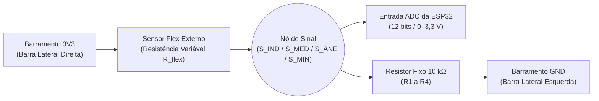

# Especificação Técnica de Hardware, Soldagem, Manufatura e Validação Elétrica

**Instituição**: Universidade de Brasília (UnB) — Faculdade de Tecnologia (FT)  
**Laboratório**: Projeto de Extensão L-VIS (Laboratório de Visualização, Interação e Simulação)  
**Escopo**: Planejamento, montagem eletromecânica, soldagem em placa universal e validação de bancada do protótipo **L-UVA**.

---

## 1. Visão Geral da Arquitetura de Hardware

O protótipo de validação da **L-UVA** integra uma unidade microcontroladora **ESP32 DevKit V1 (30 pinos)**, uma Unidade de Medição Inercial (IMU) de 6 eixos **MPU6050 (módulo GY-521)** e **sensores flexíveis resistivos** conectados por meio de divisores de tensão.

### 1.1. Equação do Divisor Resistivo dos Dedos
Cada conector leva $3,3\text{ V}$ ao sensor flexível e recebe o sinal de retorno no nó conectado simultaneamente à entrada ADC da ESP32 e a um resistor de $10\text{ k}\Omega$ aterrado ao `GND`:

$$V_{\text{ADC}} = 3,3 \cdot \frac{R_{\text{fixo}}}{R_{\text{flex}} + R_{\text{fixo}}}$$

> [!TIP]
> **Otimização de Sensibilidade**: Caso a excursão de tensão medida entre o estado reto e dobrado seja reduzida para um lote específico de sensor flexível, recomenda-se aferir a resistência nominal do sensor em repouso e sob flexão e substituir o resistor fixo de $10\text{ k}\Omega$ por um valor mais próximo da impedância média do sensor (ex.: $22\text{ k}\Omega$ ou $47\text{ k}\Omega$).

---

## 2. Mapa Elétrico e Netlist de Soldagem

### 2.1. Convenção de Barramentos Laterais (Vista pelo Lado dos Componentes)
- **Barra Lateral Esquerda (`GND` — Azul)**: Referência elétrica comum.
- **Barra Lateral Direita (`3V3` — Vermelho)**: Alimentação regulada de $3,3\text{ V}$.
- **Atenção ao Espelhamento**: Ao virar a placa universal para soldar pelo lado do cobre, as posições laterais ficam espelhadas. Ambos os barramentos devem ser identificados fisicamente com caneta permanente ou fita colorida antes do início da soldagem.

### 2.2. Netlist Completa da Placa Universal

| Rede (*Net*) | Origem | Destinos Conectados |
| :--- | :--- | :--- |
| `3V3` | Pino `3V3` da ESP32 | Barra lateral direita, pino `VCC` do MPU6050, pino 1 dos conectores `J1` a `J4` |
| `GND` | Pino `GND` da ESP32 | Barra lateral esquerda, pinos `GND` e `AD0` do MPU6050, terminal inferior de `R1` a `R4` |
| `S_IND` | Pino 2 de `J1` (Indicador) | `VP / GPIO36` (ESP32) e terminal superior de `R1` ($10\text{ k}\Omega$) |
| `S_MED` | Pino 2 de `J2` (Médio) | `D34 / GPIO34` (ESP32) e terminal superior de `R2` ($10\text{ k}\Omega$) |
| `S_ANE` | Pino 2 de `J3` (Anelar) | `D32 / GPIO32` (ESP32) e terminal superior de `R3` ($10\text{ k}\Omega$) |
| `S_MIN` | Pino 2 de `J4` (Mindinho) | `D25 / GPIO25` (ESP32) e terminal superior de `R4` ($10\text{ k}\Omega$) |
| `I2C_SCL` | Pino `SCL` do MPU6050 | `D22 / GPIO22` (ESP32) |
| `I2C_SDA` | Pino `SDA` do MPU6050 | `D21 / GPIO21` (ESP32) |
| `MPU_INT` | Pino `INT` do MPU6050 | `D27 / GPIO27` (ESP32 — opcional) |

### 2.3. Regra de Espaçamento Físico nos Pinos da ESP32
Para mitigar o risco de curto-circuito entre ilhas adjacentes e facilitar a inspeção visual, os pinos analógicos seguem a sequência intercalada:
`[VP usado]` — `[VN livre]` — `[D34 usado]` — `[D35 livre]` — `[D32 usado]` — `[D33 livre]` — `[D25 usado]`

---

## 3. Procedimento Padrão de Soldagem e Montagem Eletrônica

### 3.1. Parâmetros Térmicos
- **Solda com chumbo (SnPb)**: $320\ ^\circ\text{C}$ a $350\ ^\circ\text{C}$.
- **Solda sem chumbo (Lead-Free)**: $350\ ^\circ\text{C}$ a $380\ ^\circ\text{C}$.
- **Tempo de Contato**: Inferior a $3\text{ segundos}$ por ilha para preservar o fenolite/fibra e os componentes.

### 3.2. Sequência Incremental Recomendada
1. Desenergizar completamente a placa, limpar o barramento de cobre com álcool isopropílico e verificar ausência de oxidação.
2. Confirmar continuidade longitudinal de cada barra lateral e isolamento absoluto entre as barras de `3V3` e `GND`.
3. Soldar os soquetes/pinos da ESP32 mantendo paralelismo mecânico e conector USB voltado para a borda inferior da placa.
4. Soldar jumpers de `3V3` (barra vermelha) e `GND` (barra azul), energizar apenas via USB e aferir $\approx 3,3\text{ V}$ entre os barramentos.
5. Desenergizar, soldar o módulo **MPU6050** na porção superior da placa (orientação fixa em relação ao dorso da mão), conectar `VCC`, `GND`, `SDA`, `SCL` e `AD0`, e validar o endereço `0x68` via *I²C Scanner*.
6. Soldar `J1` e `R1`, validar o canal do dedo indicador e repetir sequencialmente para `J2` a `J4`.
7. Aplicar alívio de tração nos cabos, remover resíduos de fluxo com álcool isopropílico e escova antiestática e realizar a inspeção óptica final.

---

## 4. Integração Mecânica na Luva (Usinagem e Costura Técnica)

O acoplamento físico entre o hardware eletrônico e a luva têxtil foi desenvolvido para permitir manutenção rápida da placa sem comprometer a fixação ao tecido:

1. **Usinagem da Placa Base de Acrílico**:
   - Medição das dimensões da placa universal e marcação de corte e furação com guia mecânica (furador).
   - Corte perimetral utilizando micro retífica Dremel com disco de corte de metal.
   - Execução de **dois conjuntos de furos** com fresa de alta velocidade:
     - **Conjunto A (Fixação Têxtil)**: Furos periféricos destinados à costura da placa de acrílico diretamente no dorso da luva.
     - **Conjunto B (Fixação Eletrônica)**: Furos de montagem para parafusar a placa universal sobre a base de acrílico.
2. **Costura Estrutural e Alojamento dos Sensores Flex**:
   - A base de acrílico é posicionada no dorso da luva e costurada com fio de algodão e agulha grossa curvada, empregando amarrações do tipo **nó cirúrgico** reforçadas com adesivo de selagem para evitar deslizamento por baixa fricção superficial do fio.
   - Os **bolsinhos de elástico** sobre os dedos recebem reforço de costura ponto a ponto com agulha reta, unindo o tecido da luva às extremidades do elástico e mantendo aberturas voltadas para o dorso para inserção alinhada dos sensores flexíveis.

---

## 5. Protocolo de Inspeção, Calibração e Diagnóstico de Falhas

### 5.1. Normalização de Calibração Individual por Dedo
Como cada conjunto dedo-sensor apresenta limites mecânicos próprios, registram-se as leituras em repouso ($L_{\text{reto}}$) e em flexão máxima ($L_{\text{dobrado}}$). O fechamento normalizado em $[0, 1]$ é dado por:

$$\text{fechamento} = \text{limitar}\left(\frac{L - L_{\text{reto}}}{L_{\text{dobrado}} - L_{\text{reto}}}, \ 0, \ 1\right)$$

### 5.2. Matriz de Diagnóstico Rápido (Troubleshooting)

| Sintoma Observado | Causa Provável | Ação de Verificação / Correção |
| :--- | :--- | :--- |
| **Leitura próxima de `0`** | Sinal aterrado, ausência de `3V3` ou sensor aberto | Medir tensão no nó e continuidade do conector `J1`–`J4` |
| **Leitura travada em `4095`** | Resistor de $10\text{ k}\Omega$ sem `GND` ou curto com `3V3` | Medir continuidade do terminal inferior do resistor até o `GND` |
| **Valor altamente instável** | Entrada ADC flutuando, solda fria ou cabo longo sem referência | Confirmar conexão do divisor resistivo e refazer a junta de solda |
| **Dois dedos variam juntos** | Ponte de solda acidental entre trilhas/pinos de sinal | Testar continuidade cruzada entre `S_IND`, `S_MED`, `S_ANE` e `S_MIN` |
| **MPU6050 não encontrado** | `SDA`/`SCL` invertidos, `GND` ausente ou `AD0` flutuando | Executar *I²C Scanner* (verificar `0x68`) e aferir alimentação $3,3\text{ V}$ |
| **Falha no `GPIO25` com rádio ativo** | Conflito de hardware entre `ADC2` e pilha Wi-Fi/ESP-NOW | Utilizar exclusivamente pinos do `ADC1` (`GPIO32`–`GPIO39`) ao ativar Wi-Fi |

### 5.3. Checklist de Aceitação de Bancada
- [x] Barramentos laterais identificados (`3V3` vermelho / `GND` azul) e eletricamente isolados entre si.
- [x] Tensão de $3,3\text{ V}$ estável confirmada entre os barramentos sob alimentação USB.
- [x] Pino `VIN` ($5\text{ V}$) desconectado da malha de sensores e do MPU6050.
- [x] Módulo MPU6050 detectado no endereço $\text{I}^2\text{C}$ `0x68`.
- [x] Pinos intercalados (`VN`, `D35`, `D33`) livres de solda na placa de validação de 4 canais.
- [x] Quatro/cinco resistores de $10\text{ k}\Omega$ individualmente aterrados ao barramento `GND`.
- [x] Ausência de continuidade cruzada entre os sinais analógicos dos dedos.
- [x] Resposta monotônica, repetível e sem saturação permanente em `0` ou `4095` em todos os dedos.
