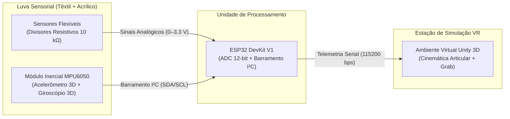
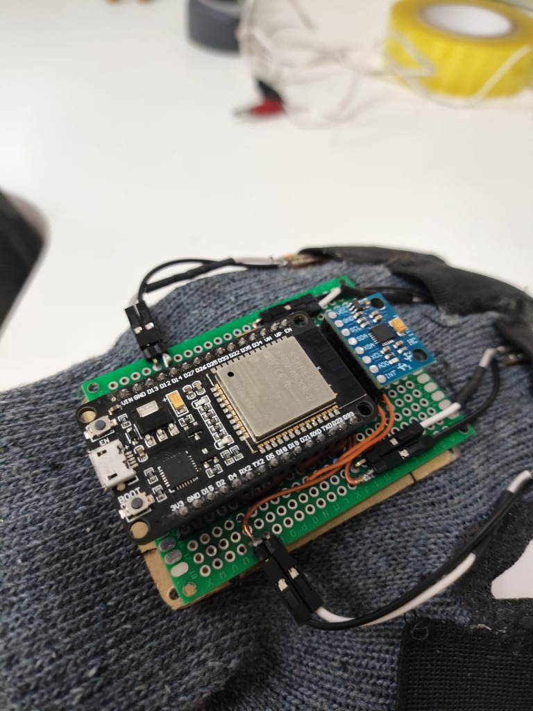
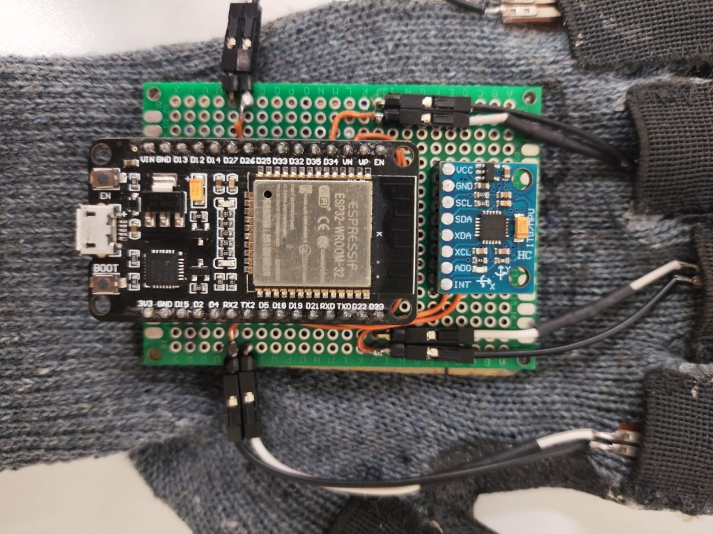

# Hardware, Eletrônica e Montagem Mecânica — L-UVA

Este diretório reúne as especificações elétricas, o mapeamento de pinos, o leiaute de placa universal e o processo de integração eletromecânica na luva têxtil do projeto **L-UVA**.

---

## 1. Arquitetura Eletrônica do Protótipo

O sistema eletrônico da **L-UVA** foi projetado sob a premissa de **baixo custo, alta reprodutibilidade e facilidade de manutenção e inspeção**:

### 1.1. Condicionamento de Sinal (Divisor Resistivo)
Cada sensor flexível atua como um resistor variável ($R_{\text{flex}}$) alimentado em $3,3\text{ V}$, formando um divisor de tensão com um resistor fixo de *pull-down* ($R_{\text{fixo}} = 10\text{ k}\Omega$) conectado ao barramento `GND`:

$$V_{\text{ADC}} = 3,3 \cdot \frac{R_{\text{fixo}}}{R_{\text{flex}} + R_{\text{fixo}}}$$

> [!WARNING]
> **Proteção de Nível Lógico (3,3 V)**: Nunca utilize o pino `VIN` ($5\text{ V}$) nos sensores flexíveis, no módulo MPU6050 ou nas entradas analógicas da ESP32. Todos os GPIOs operam com tensão máxima de $3,3\text{ V}$.

---

## 2. Mapa de Pinagem e Redes Elétricas (Netlist)

### 2.1. Interligação MPU6050 $\leftrightarrow$ ESP32 (Barramento $\text{I}^2\text{C}$)

| Pino MPU6050 | Destino na ESP32 / Placa | Função Elétrica |
| :--- | :--- | :--- |
| `VCC` | Barramento `3V3` (Direito) | Alimentação regulada de $3,3\text{ V}$ |
| `GND` | Barramento `GND` (Esquerdo) | Referência elétrica comum |
| `SCL` | `D22 / GPIO22` | Clock do barramento $\text{I}^2\text{C}$ |
| `SDA` | `D21 / GPIO21` | Dados do barramento $\text{I}^2\text{C}$ |
| `AD0` | Barramento `GND` | Fixa o endereço $\text{I}^2\text{C}$ primário em `0x68` |
| `INT` | `D27 / GPIO27` | Pino de interrupção (opcional) |
| `XDA` / `XCL` | Sem ligação (NC) | Barramento auxiliar não utilizado |

### 2.2. Distribuição Analógica (Protótipo em Placa Universal)
Na montagem em placa universal de validação, adotou-se o espaçamento de **um pino físico livre** entre cada entrada analógica soldada na lateral da ESP32, reduzindo drasticamente o risco de pontes de solda e facilitando a inspeção óptica:

| Conector | Dedo | Pino ESP32 | Observação de Layout |
| :--- | :--- | :--- | :--- |
| **J1** | Indicador | `VP / GPIO36` (ADC1) | 1º canal utilizado |
| — | *Espaçamento* | `VN / GPIO39` | Mantido livre para isolamento físico |
| **J2** | Médio | `D34 / GPIO34` (ADC1) | 2º canal utilizado |
| — | *Espaçamento* | `D35 / GPIO35` | Mantido livre para isolamento físico |
| **J3** | Anelar | `D32 / GPIO32` (ADC1) | 3º canal utilizado |
| — | *Espaçamento* | `D33 / GPIO33` | Mantido livre para isolamento físico |
| **J4** | Mindinho | `D25 / GPIO25` (ADC2) | 4º canal utilizado (uso via USB Serial) |

*(Nota: No firmware de 5 dedos em `firmware/src/main_luva_freertos.cpp`, os cinco canais utilizam exclusivamente o `ADC1` nos pinos `GPIO34`, `GPIO35`, `GPIO32`, `GPIO33` e `GPIO36/VP`, garantindo total compatibilidade futura com rádio Wi-Fi/ESP-NOW).*

---

## 3. Integração Mecânica e Ergonomia Vestível

Para assegurar robustez mecânica durante o uso contínuo em Realidade Virtual sem comprometer a flexibilidade da mão:

1. **Base Estrutural em Acrílico Usinado**:
   - Uma placa de acrílico é cortada nas dimensões exatas da placa de circuito utilizando micro retífica e disco de corte.
   - Possui **duas matrizes de furação independentes** feitas com fresa de alta velocidade:
     - **Furos de Costura**: Permitem fixar a base de acrílico ao dorso da luva têxtil por meio de fio de algodão com agulha curvada e amarrações do tipo "nó cirúrgico" seladas.
     - **Furos de Parafusamento**: Permitem acoplar e remover a placa eletrônica da base de acrílico sem desfazer a costura na luva, facilitando manutenções e reparos.
2. **Guias Têxteis para Sensores Flex**:
   - Bolsinhos de elástico são costurados ponto a ponto ao longo das falanges dos dedos na luva, mantendo aberturas voltadas para o dorso para inserção suave e alinhamento axial dos sensores flexíveis durante a flexão.

Para o procedimento passo a passo de soldagem, parâmetros térmicos ($320\ ^\circ\text{C}$–$380\ ^\circ\text{C}$) e checklist de validação elétrica, consulte [docs/hardware-e-soldagem.md](../docs/hardware-e-soldagem.md) e a lista de materiais em [BOM.md](BOM.md).

---

## 4. Galeria do Protótipo Físico Construído (L-VIS / UnB)

| Vista Superior Completa (5 Dedos) | Detalhe em Perspectiva (Acrílico + Placa) | Vista Macro (Conexões ESP32 & MPU6050) |
| :---: | :---: | :---: |
|  |  |  |
| *Luva instrumentada com 5 sensores flexíveis em bolsinhos de elástico e conectores de 2 vias.* | *Sobreposição mecânica: luva têxtil $\rightarrow$ base de acrílico usinada $\rightarrow$ placa universal.* | *Detalhe do roteamento em jumpers sólidos laranja, ESP32-WROOM-32 e módulo GY-521 (MPU6050).* |

