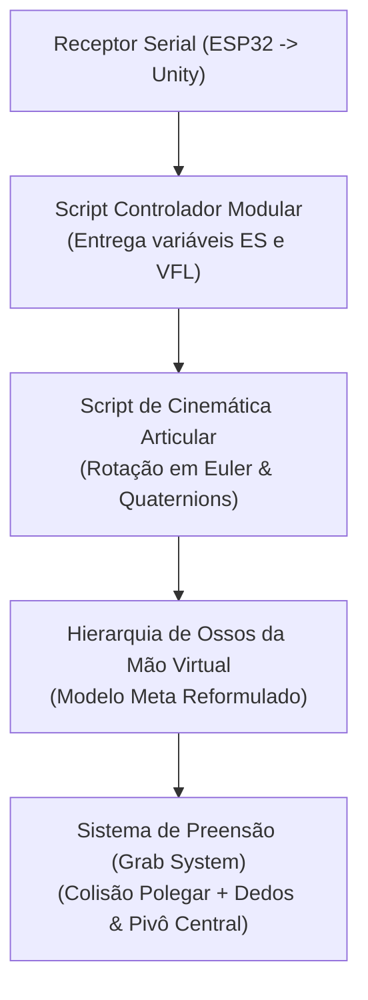

# Simulação 3D e Interação Virtual — Unity (`L-UVA`)

> [!IMPORTANT]
> **Diretório Reservado para o Projeto Unity 3D**: Esta pasta está estruturada e reservada para receber os arquivos do projeto Unity desenvolvidos pela equipe de simulação do **L-VIS / UnB** (`Assets/`, `Packages/`, `ProjectSettings/`). O arquivo [`.gitignore`](../.gitignore) na raiz do repositório já está configurado para ignorar pastas temporárias (`Library/`, `Temp/`, `Logs/`, `Obj/`) assim que o projeto for integrado.

---

## 1. Arquitetura do Ambiente de Simulação

O módulo de simulação em **Unity 3D** traduz, em tempo real, o fluxo de dados seriais provenientes da **ESP32** (estados discretizados de flexão dos dedos e orientação inercial da IMU) em movimentos biomecanicamente coerentes e interações físicas com objetos virtuais.

---

## 2. Pilares Técnicos Implementados

### 2.1. Rigging e Design da Mão Virtual
- **Modelo Base**: Foi adotada uma malha tridimensional de mão disponibilizada pela **Meta**, cujos ossos (*bones*) e hierarquia de *rigging* foram integralmente reformulados pela equipe do L-VIS para permitir o controle paramétrico direto de cada falange dentro da Unity.

### 2.2. Modelo Matemático de Tracking e Movimento Articular
Em substituição a scripts monolíticos de difícil manutenção, foi projetada uma arquitetura limpa baseada em **estados discretos de posição**. Após a análise cinemática do fechamento e abertura da mão voltada para a preensão de objetos, a trajetória de rotação de cada articulação dos dedos (operando tanto em ângulos de **Euler** quanto em **Quaternions**) é governada pela expressão matemática:

$$\theta_{\text{articulação}} = \left(\frac{\text{NMF}}{\text{ES}}\right) \times \text{VFL} + \text{VRR}$$

Onde:
- **$\text{NMF}$** (*Número Máximo da Flexão*): Amplitude angular máxima da articulação no fechamento completo;
- **$\text{ES}$** (*Quantidade de Estados*): Resolução discreta de posições possíveis (ex.: $20$ estados enviados pelo firmware);
- **$\text{VFL}$** (*Valor da Flexão da Luva*): Estado atual lido do sensor flexível do respectivo dedo ($0 \le \text{VFL} < \text{ES}$);
- **$\text{VRR}$** (*Valor de Rotação em Repouso*): Ângulo basal da articulação quando a mão está completamente aberta.

### 2.3. Arquitetura de Controle Modular
- O sistema separa estritamente a **camada de atuação cinemática** da **camada de aquisição de dados**.
- Um **Script Controlador Modular** injeta as variáveis $\text{ES}$ e $\text{VFL}$ nos scripts de rotação de cada osso, permitindo alternar de forma transparente entre testes em editor (simulação manual) e a recepção em tempo real dos pacotes seriais do microcontrolador ESP32.

### 2.4. Sistema de Preensão Física (*Grab Function*)
- Utiliza o sistema de parentesco dinâmico (*Transform Parenting*) e detecção de colisão da Unity:
  - **Condição de Captura**: Quando um objeto interativo entra simultaneamente em contato com o **dedo polegar** e **qualquer outro dedo da mão**, o objeto passa a seguir a translação e a rotação de um **eixo pivô invisível** posicionado no centro da palma da mão.
  - **Condição de Liberação**: No instante em que a condição de pinça/contato deixa de ser satisfeita (abertura dos dedos), o parentesco é desfeito e o objeto é liberado no espaço virtual.

---

## 3. Roadmap de Simulação (Próximos Desafios)

- [ ] **Integração do Pacote Unity no Repositório**: Upload das pastas `Assets/`, `Packages/` e `ProjectSettings/`.
- [ ] **Refinamento da Animação de *Grab***: Suavização por interpolação esférica (`Quaternion.Slerp`) no acoplamento do objeto à palma.
- [ ] **Envelopamento de *Hitbox* da Mão**: Otimização dos colisores compostos (*Compound Colliders*) ao redor das falanges e palma para colisões físicas de alta precisão com objetos complexos.
